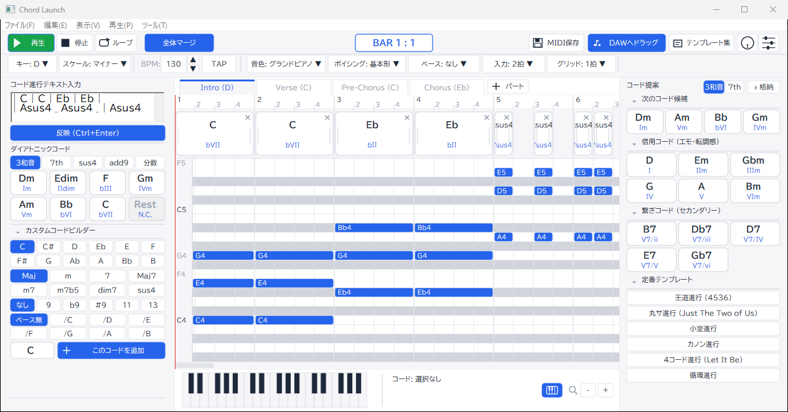

# ChordLaunch

> [!IMPORTANT]
> ## 生成AI使用表明 / AI Usage Disclosure
>
> 本プロジェクトのコード・ドキュメントは、生成AI **Gemini 4 Argon**、**Gemini 3.8 Flash**、**Claude Sonnet 5.5** を使用して作成・改修しています。
>
> This project's code and documentation were created and modified with generative AI: **Gemini 4 Argon**, **Gemini 3.8 Flash** and **Claude Sonnet 5.5**.



Windows 向け超軽量・高速コード進行演奏・音楽理論支援デスクトップアプリケーション。

C++20 ネイティブ（Win32 + Direct2D / DirectWrite + WASAPI + OLE Drag & Drop）により構築されており、DAW との同時起動時でも CPU・メモリへの負荷を最小限に抑え、瞬時起動（50ms 未満）と高レスポンスを実現します。

## 特長

- **超軽量・高速動作**:
  - 起動時間 50ms 未満、RAM 使用量 20MB 前後、アイドル時 CPU 0.0%。
  - ランタイム不要・完全静的リンク（`/MT`）による単一実行ファイル（約 400KB）。
- **洗練された 3 ペイン UI（暖色系ライトテーマ ＋ UDフォント）**:
  - タイトルバー重複表示を排除し、作業領域を最大化。
  - 原則 UD フォント（BIZ UDPゴシック）を採用し、見切れやはみ出しを防止。
- **入力の二重化（左ペイン統合）**:
  - テキスト入力エリアとダイアトニックコード（Ⅰ〜Ⅶ）パレット・休符（`Rest / N.C.`）を同一ペインに配置し、テキスト打ち込みとカード操作の双方を視線移動なしで完結。
  - スケール外・カスタムコードを直感的に組み立てられるクイックビルダー（12音ルート × クオリティ × テンション × オンベース）。
- **DAW ライクなタイムライン編集**:
  - DAW スタイルのタイムルーラー、スムーズに移動するプレイヘッド、クリックシーク再生。
  - ルーラー上のドラッグによるループ／再生範囲選択。
  - コード追加入力時にタイムラインが自動追従スクロール（先頭戻りの解消）。
  - 複数コード選択（Ctrl/Shift/ラバーバンド）およびコピペ（`Ctrl+C`, `Ctrl+X`, `Ctrl+V`, `Ctrl+D`, `Del`）。
  - すべてのコードカードでダブルクリック追加およびタイムラインへの D&D に対応。
- **パート別コード入力 ＆ 転調・全体マージ**:
  - パート（Intro, Aメロ, Bメロ, サビ等）ごとに個別の Key / Scale を設定してコード進行を編集可能。
  - 全パートをワンクリックで結合（マージ）し、転調小節へキー変更マーカーを自動割り当てした1本の統合タイムラインを生成。
- **DAW へのシームレスなドラッグ＆ドロップ**:
  - ツールバーのボタンから DAW（Studio One, Cubase, Pro Tools, Reaper 等）のトラックへ直接 `.mid` ファイルをドラッグ＆ドロップ（`CF_HDROP`）して取り込み可能。
- **音楽理論パレット（単一スクロール）**:
  - 同主調借用和音（モーダルインターチェンジ）、セカンダリードミナント、裏コード、定番進行テンプレートを単一の滑らかなスクロールバーで一覧操作。
- **完全な日英ローカライズ**:
  - 英語モード切替時に日本語が一切残らない動的辞書アーキテクチャ。

## 開発環境とビルド

### 必要要件
- Windows 10 / 11 (x64)
- Visual Studio 2022 / 2026 (MSVC C++20 サポート)
- CMake 3.25 以上
- Ninja、ccache（任意だが推奨）、`../cmake/CppOptimization.cmake`（ワークスペース共通モジュール）

### ビルド手順

本プロジェクトは Ninja + `CMakePresets.json` を前提とします（Visual Studio ジェネレータ用の `cmake -B build -A x64` は使用しません）。MSVC x64 環境（`vcvars64.bat`）をロードした上で実行してください。下記のスクリプトは環境ロード・ビルド・単体テスト実行を自動で行います。

```powershell
# 推奨: 共通スクリプト（H:\Antigravity\cmake）。Mode は dev-fast / release-max / pgo
& ..\cmake\Invoke-CppFastBuild.ps1 -Project ChordLaunchpad -Mode dev-fast
```

手動で実行する場合（`vcvars64.bat` ロード済みの Developer PowerShell で実行）:

```powershell
cmake --preset release-max
cmake --build --preset release-max

# 自動テスト実行
& .\build\clp_tests.exe
```

| プリセット | 出力先 | 用途 |
| :--- | :--- | :--- |
| `release-max` | `build/` | 最大最適化（/O2 /GL /LTCG /arch:AVX2） |
| `dev-fast` | `build-dev/` | 開発用高速ビルド（lld-link） |
| `pgo-instrument` / `pgo-optimize` | `build-pgo/` | PGO 2段階ビルド |

生成物は `ChordLaunch.exe`（本体）と `clp_tests.exe`（単体テスト）です。
